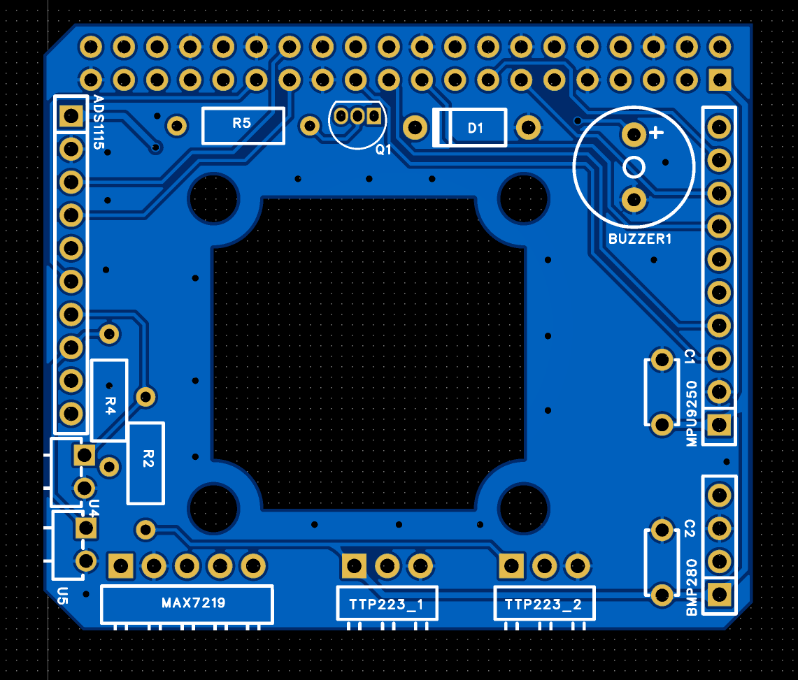
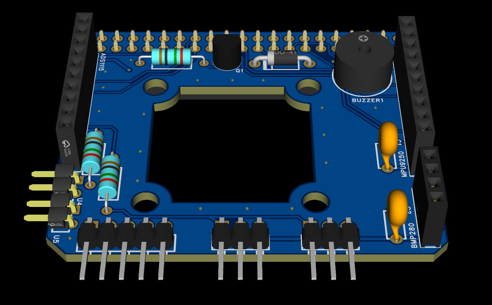

# Gerber_PCB1

This folder contains the full set of **Gerber files, drill data, and schematic** required for manufacturing and testing the PCB design.

|||
|--|--|
|||

---

## 📁 Directory Contents

| File Name                          | Description                                 |
| ---------------------------------- | ------------------------------------------- |
| `Drill_NPTH_Through.DRL`           | Non-plated through-hole drill data          |
| `Drill_PTH_Through.DRL`            | Plated through-hole drill data              |
| `Drill_PTH_Through_Via.DRL`        | Via drill data (plated through vias)        |
| `FlyingProbeTesting.json`          | Configuration for flying probe test systems |
| `Gerber_BoardOutlineLayer.GKO`     | Board mechanical outline                    |
| `Gerber_BottomLayer.GBL`           | Bottom copper layer                         |
| `Gerber_BottomSilkscreenLayer.GBO` | Bottom silkscreen layer                     |
| `Gerber_BottomSolderMaskLayer.GBS` | Bottom solder mask layer                    |
| `Gerber_DocumentLayer.GDL`         | Documentation / assembly notes layer        |
| `Gerber_DrillDrawingLayer.GDD`     | Drill drawing for reference                 |
| `Gerber_TopLayer.GTL`              | Top copper layer                            |
| `Gerber_TopSilkscreenLayer.GTO`    | Top silkscreen layer                        |
| `Gerber_TopSolderMaskLayer.GTS`    | Top solder mask layer                       |
| `Schematic.pdf`                    | Full schematic diagram in PDF format        |

---

## 🛠️ Usage Instructions

- This directory can be directly used for **PCB fabrication and testing**.
- Gerber and drill files conform to standard RS-274X format, suitable for most PCB manufacturers.
- Use `FlyingProbeTesting.json` if your manufacturer supports automated electrical test (AET).

---

## 🧾 Notes

- Ensure drill layers are interpreted correctly — especially NPTH vs PTH separation.
- The outline file `.GKO` defines the finished board shape and cutouts.
- Schematic included for BOM verification and component placement.
